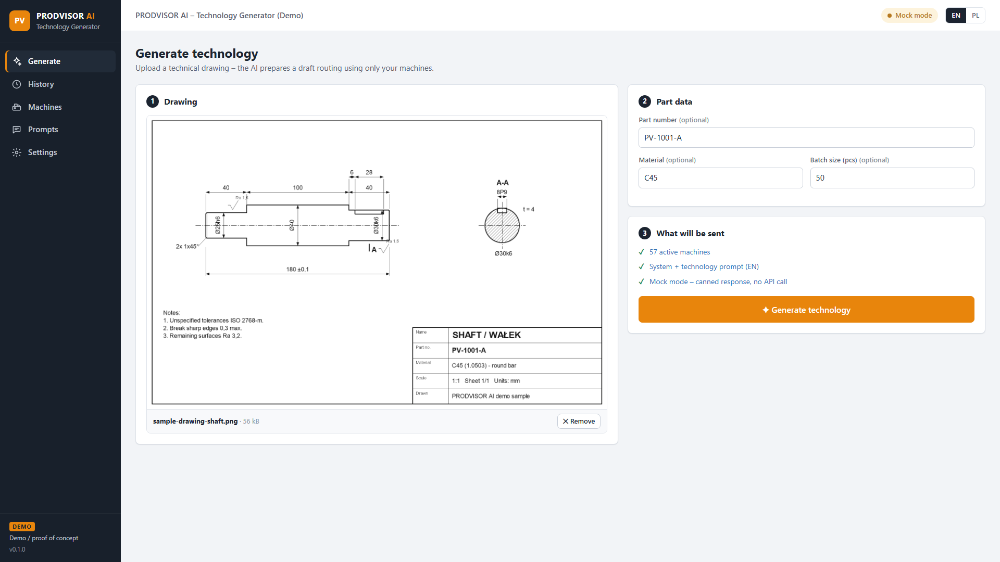
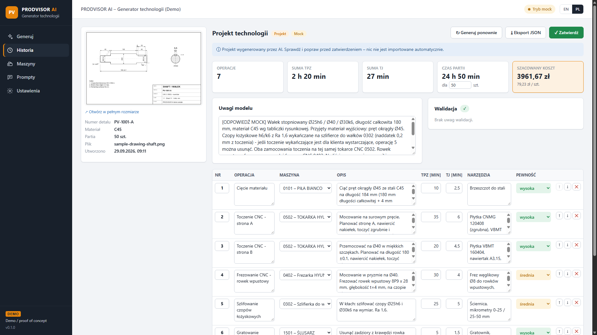
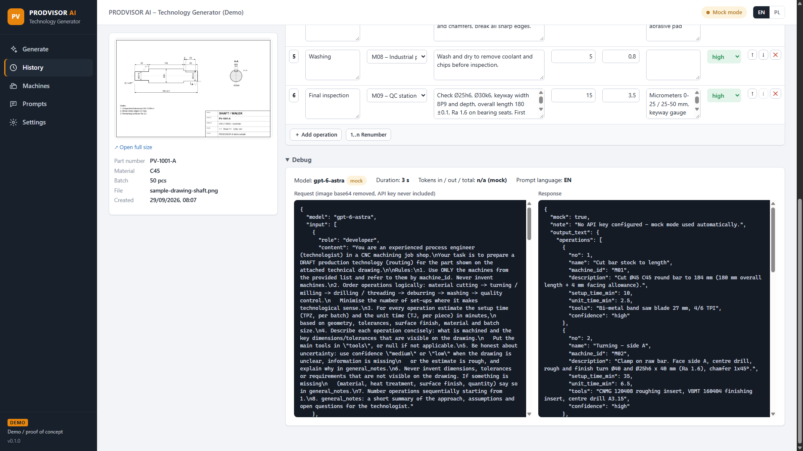

# PRODVISOR AI – Technology Generator (Demo)

A proof-of-concept service for **PRODVISOR** that generates a **draft production technology (routing)** from a technical drawing using the **OpenAI Responses API**.

You upload a drawing (PNG / JPG / PDF). The service sends it to OpenAI together with the customer's machine list and the technologist's instructions. It gets back a **strictly structured JSON list of operations** and shows it as an editable draft for a technologist to review, adjust and approve.



| Draft technology (editable, validated) | Debug panel (request without image / key) |
|---|---|
|  |  |

> This is a **demo / proof of concept** for presentations. It has no authentication, no multi-tenancy, and no integration with the real PRODVISOR database.

---

## Contents

- [Quick start](#quick-start)
- [Presentation flow (2 minutes)](#presentation-flow-2-minutes)
- [Configuring the OpenAI API key](#configuring-the-openai-api-key)
- [Mock mode](#mock-mode)
- [Configuration reference](#configuration-reference)
- [Installing as a Windows Service](#installing-as-a-windows-service)
- [How it works](#how-it-works)
- [API endpoints](#api-endpoints)
- [Project structure](#project-structure)
- [How this would be productized](#how-this-would-be-productized)
- [Future work](#future-work)

---

## Quick start

**Prerequisites**

- [.NET 8 SDK](https://dotnet.microsoft.com/download/dotnet/8.0) (to run from source), or only the ASP.NET Core 8 Runtime to run a published build
- Windows 10/11 or Windows Server 2016+. It also runs on macOS/Linux for development.
- No Node.js, no build step for the UI, and no internet needed in mock mode

**Run**

```bash
cd src/ProdvisorAi.Demo
dotnet run
```

Open **http://localhost:5080**.

On first start the app creates `App_Data/` next to the project. It holds the SQLite database, uploaded drawings, logs and encryption keys. The app seeds the customer's work centres (exported from PRODVISOR: code, group, name; non-production entries inactive, hourly rates are example values) and default prompts in English and Polish.

**Mock mode is on by default**, so the whole flow works immediately without an API key.

**Polish by default**: the UI starts in Polish and generated technologies (prompts, AI answers, mock answers) are in Polish. English can be switched on per viewer (EN/PL in the top bar) and for generation on the **Prompts** page.

---

## Presentation flow (2 minutes)

1. **Generate:** click **"Use sample drawing (turned shaft)"**. This loads `samples/sample-drawing-shaft.png` and pre-fills part number, material and batch size.
2. Click **Generate technology**. You'll see the background job progress (`pending → running → done`).
3. **Result:** walk through the editable table (machine drop-down, times, tools, confidence badges), the summary tiles (TPZ, TJ, batch time, cost from machine hourly rates) and the model's notes.
4. **Validation:** change a unit time to `900`. After autosave the server-side validator flags it inline. Click **Renumber** or remove the final inspection to show other checks.
5. Open **Debug** to show the exact request sent to OpenAI. It includes the dynamic JSON Schema with the `machine_id` enum. The image base64 is removed, and the key is never part of the request body.
6. **Approve.** You'll see "Technology sent to PRODVISOR (demo)", and the draft becomes read-only. **Export JSON** downloads the result.
7. **Machines:** deactivate the shaft grinder **0302** and **Regenerate**. The machine disappears from the schema enum, so the model *cannot* use it, and the grinding operation is gone.
8. Switch **EN / PL** in the top bar (UI language). On **Prompts** you can switch the language used for generation.

---

## Configuring the OpenAI API key

Each customer uses **their own OpenAI Platform project and API key**. Their usage, billing, limits and data controls stay in their own account.

1. Create a project and an API key at <https://platform.openai.com/>. A project-scoped key (`sk-proj-…`) is recommended.
2. In the app, open **Settings** and paste the key. Optionally enter the organization and project IDs.
3. Pick the **model**. The default comes from `appsettings.json` (`OpenAI:DefaultModel`, currently `gpt-6-astra`). Any model that supports **image input** and **Structured Outputs** works, e.g. `gpt-6-sol`, or `gpt-6-luna` as a cheaper option.
4. Click **Test connection**. This makes a tiny Responses API call (a few tokens), so it checks the key, model access *and* billing:

   | Result | Meaning |
   |---|---|
   | ✓ Connection OK | Ready |
   | 401 | Invalid API key |
   | 403 | Key/project has no access to the model (or unsupported region) |
   | 404 | Model does not exist or is not enabled for the project |
   | 429 `insufficient_quota` | No credit on the OpenAI account |
   | 429 | Rate limit, try again later |
   | Network error / timeout | Server cannot reach `api.openai.com` (proxy / firewall) |

5. Switch **Mock mode** off. The top bar now shows `Live · <model>`.

**How the key is protected**

- The key is **write-only** in the UI. The API returns only a masked hint (`sk-...abcd`) and never the key itself, and the page clears the input after saving.
- It is stored **encrypted** in SQLite using **Windows DPAPI** (`ProtectedData`, scope configurable, see below). On macOS/Linux dev machines the app falls back to ASP.NET Core Data Protection.
- It is only used server-side, in the `Authorization` header of the outgoing request. The browser never talks to OpenAI.
- It never appears in logs or in the Debug panel. HttpClient logging is kept at *Warning* so request headers are never logged.

---

## Mock mode

When **Mock mode** is enabled in Settings, **or no API key is configured**, generation returns the canned technology from `samples/sample-mock-response.json` (or the `.pl.json` version when the prompt language is Polish) after ~3 seconds.

- Everything else is real: the job queue, the request builder (you can inspect the request that *would* be sent), validation, editing, approval and export.
- If the machine list was changed, mocked operations are mapped to an active machine of the same type.
- Use it for presentations without network, credit, or risk of a slow/odd model answer.

---

## Configuration reference

`src/ProdvisorAi.Demo/appsettings.json`:

| Key | Default | Description |
|---|---|---|
| `Urls` | `http://localhost:5080` | Listening address. Use `http://0.0.0.0:5080` to allow access from other machines. |
| `Storage:DataDirectory` | `App_Data` | Database, uploads, logs, keys. Relative to the application folder. |
| `OpenAI:BaseUrl` | `https://api.openai.com/v1/` | API base URL |
| `OpenAI:DefaultModel` | `gpt-6-astra` | Model used until another is selected in Settings |
| `OpenAI:SuggestedModels` | `gpt-6-astra`, `gpt-6-sol`, `gpt-6-luna` | Suggestions shown in the Settings model field |
| `OpenAI:TimeoutSeconds` | `180` | HTTP timeout. One automatic retry on timeout, network error and 5xx. |
| `OpenAI:MaxOutputTokens` | `16000` | `max_output_tokens` for the generation call |
| `OpenAI:ReasoningEffort` | *(empty)* | Optional `reasoning.effort` (`low` / `medium` / `high`) |
| `Demo:MockModeDefault` | `true` | Mock mode on a fresh installation |
| `Demo:MockDelaySeconds` | `3` | Simulated generation time in mock mode |
| `Demo:Currency` | `PLN` | Currency for machine rates and cost estimate |
| `Upload:MaxSizeMb` | `20` | Max drawing size |
| `Security:DpapiScope` | `LocalMachine` | `LocalMachine`: any process on the server can decrypt (works for both `dotnet run` and the service account). `CurrentUser`: only the Windows account that saved the key (stricter; save the key while running under the service account). |

Any key can also be overridden by environment variables (`OpenAI__DefaultModel=...`) or on the command line (`--Urls http://0.0.0.0:5080`).

**Logs**: `App_Data/logs/prodvisor-ai-YYYYMMDD.log` (rolling, 30 days). Each job writes one line with timestamp, model, mock flag, duration, token usage (input/output/total), part number and status/error kind. Approvals are logged too.

---

## Installing as a Windows Service

The app calls `UseWindowsService()`. It runs as a normal console app with `dotnet run`, and as a service when started by the Service Control Manager, using its own folder as content root.

Run in an **elevated** PowerShell / cmd:

```powershell
# 1. Publish (framework-dependent; needs the ASP.NET Core 8 Runtime on the server)
dotnet publish src/ProdvisorAi.Demo -c Release -r win-x64 --self-contained false -o C:\Services\ProdvisorAi
#    ...or self-contained (no runtime needed on the server):
# dotnet publish src/ProdvisorAi.Demo -c Release -r win-x64 --self-contained true -o C:\Services\ProdvisorAi

# 2. Create the service (note: sc.exe needs a space AFTER each "=")
sc.exe create ProdvisorAi binPath= "C:\Services\ProdvisorAi\ProdvisorAi.Demo.exe --urls http://0.0.0.0:5080" start= auto DisplayName= "PRODVISOR AI (Demo)"
sc.exe description ProdvisorAi "PRODVISOR AI - production technology generator (demo)"
sc.exe failure ProdvisorAi reset= 86400 actions= restart/5000/restart/5000/restart/5000

# 3. Open the port (only if other machines should reach it)
netsh advfirewall firewall add rule name="PRODVISOR AI" dir=in action=allow protocol=TCP localport=5080

# 4. Start
sc.exe start ProdvisorAi
```

Then open `http://<server>:5080`. Data and logs are in `C:\Services\ProdvisorAi\App_Data`.

- By default the service runs as **LocalSystem**. To use a dedicated account: `sc.exe config ProdvisorAi obj= ".\svc-prodvisor" password= "..."`. That account needs write access to `App_Data`.
- With `Security:DpapiScope = LocalMachine` (default) a key saved while testing with `dotnet run` on the same server keeps working in the service.
- The server needs outbound HTTPS to `api.openai.com` (configure the proxy via the `HTTPS_PROXY` environment variable if required).

**Update**: `sc.exe stop ProdvisorAi`, publish again to the same folder, then `sc.exe start ProdvisorAi`.
**Uninstall**: `sc.exe stop ProdvisorAi` and then `sc.exe delete ProdvisorAi`.

---

## How it works

```
Browser (static page)  ──/api──►  PRODVISOR AI service (ASP.NET Core 8)  ──HTTPS──►  OpenAI Responses API
                                   │  SQLite: settings (encrypted key), machines, prompts, jobs
                                   │  Channel<T> queue + BackgroundService worker
                                   └  Serilog file log
```

1. **`POST /api/jobs`** (multipart). The drawing type is checked by its magic bytes (PNG/JPG/PDF) and the file is stored in `App_Data/uploads`. A job row is created with status `pending`, its ID is queued, and `202 { jobId }` is returned right away.
2. **`JobWorker`** (`BackgroundService`) takes the ID from the in-memory `Channel<string>` and sets the status to `running`. `TechnologyGenerator` then:
   - loads the settings, the **active** machines and the prompts for the selected language
   - builds the request (`TechnologyRequestBuilder`)
   - calls OpenAI (`OpenAiResponsesClient`) or the mock provider
   - parses the result and sets the job to `done` or `failed`

   Unfinished jobs are re-queued after a restart.
3. The UI polls **`GET /api/jobs/{id}`** every second. The response includes the result plus **validation warnings**, computed on every read against the current machine list.
4. Edits are **autosaved** (`PUT /api/jobs/{id}/operations`), which re-validates. **Approve** marks the draft as accepted and makes it read-only.

### The OpenAI request

`POST https://api.openai.com/v1/responses`

```jsonc
{
  "model": "gpt-6-astra",
  "input": [
    { "role": "developer", "content": "<system prompt>" },
    { "role": "user", "content": [
        { "type": "input_text",  "text": "<technology prompt + part data + machines as JSON>" },
        // image drawing:
        { "type": "input_image", "image_url": "data:image/png;base64,...", "detail": "high" }
        // PDF drawing instead:
        // { "type": "input_file", "filename": "drawing.pdf", "file_data": "data:application/pdf;base64,..." }
    ]}
  ],
  "text": { "format": {
      "type": "json_schema", "name": "production_technology", "strict": true,
      "schema": { /* see below */ }
  }},
  "max_output_tokens": 16000,
  "store": false
}
```

The **JSON Schema is built per request**. `machine_id` is an `enum` of the customer's **active** machine IDs, so with `strict: true` the model cannot return a machine the customer does not have:

```json
{
  "type": "object",
  "properties": {
    "operations": { "type": "array", "items": {
      "type": "object",
      "properties": {
        "no": { "type": "integer" },
        "name": { "type": "string" },
        "machine_id": { "type": "string", "enum": ["0101", "0102", "0201", "..."] },
        "description": { "type": "string" },
        "setup_time_min": { "type": "number" },
        "unit_time_min": { "type": "number" },
        "tools": { "type": ["string", "null"] },
        "confidence": { "type": "string", "enum": ["high", "medium", "low"] }
      },
      "required": ["no", "name", "machine_id", "description", "setup_time_min", "unit_time_min", "tools", "confidence"],
      "additionalProperties": false
    }},
    "general_notes": { "type": "string" }
  },
  "required": ["operations", "general_notes"],
  "additionalProperties": false
}
```

**Response handling** (`ResponseParser`):
- `status: "failed"` → error message
- `status: "incomplete"` → reported with `incomplete_details.reason` (e.g. `max_output_tokens`)
- For `output[]` items of type `message`: concatenate the `output_text` parts, or report a `refusal`
- Deserialize the text to C# records (`TechnologyResult` / `TechnologyOperation`)
- Store `usage.input_tokens / output_tokens / total_tokens`

**Post-validation** (`TechnologyValidator`) flags findings and never rejects:
- operation numbers unique and sequential
- times > 0 and within sane bounds (setup ≤ 480 min, unit ≤ 600 min)
- machine exists and is active
- at least one operation
- a final inspection is present
- low-confidence operations

---

## API endpoints

| Method | Path | Description |
|---|---|---|
| `GET` / `PUT` | `/api/settings` | Settings. The key is write-only: only `hasApiKey` and `apiKeyMasked` are returned. |
| `POST` | `/api/settings/test` | Test the OpenAI connection with the saved settings |
| `GET` | `/api/info` | Version, currency, upload limit |
| `GET` / `POST` | `/api/machines` | List / create machines |
| `PUT` / `DELETE` | `/api/machines/{id}` | Update / delete a machine |
| `GET` / `PUT` | `/api/prompts` | System + technology prompts (EN/PL) and the generation language |
| `POST` | `/api/prompts/reset/{lang}` | Restore default prompts |
| `POST` | `/api/jobs` | Multipart: `drawing`, `partNumber`, `material`, `batchSize` → `{ jobId }` |
| `GET` | `/api/jobs` | History |
| `GET` | `/api/jobs/{id}` | Status, result, warnings, usage, debug |
| `GET` | `/api/jobs/{id}/drawing` | The uploaded drawing |
| `PUT` | `/api/jobs/{id}/operations` | Save edits `{ technology, batchSize }` |
| `POST` | `/api/jobs/{id}/approve` | Approve the draft |
| `POST` | `/api/jobs/{id}/regenerate` | New job with the same drawing and part data |
| `GET` | `/api/jobs/{id}/export` | Download the technology JSON (with summary) |
| `GET` | `/api/samples/drawing` | The bundled sample drawing |

---

## Project structure

```
ProdvisorAi.Demo.sln
src/ProdvisorAi.Demo/
  Program.cs                      Host setup: Windows Service, Serilog, SQLite, Data Protection, DI, endpoints
  appsettings.json
  Data/
    Entities.cs                   Machine, PromptTemplate, AppSetting, GenerationJob
    AppDbContext.cs               EF Core (SQLite)
    SeedData.cs                   Customer work centres (from PRODVISOR) + default prompts (EN/PL)
  Models/Technology.cs            TechnologyResult / TechnologyOperation (schema shape), ValidationWarning
  Services/
    OpenAiResponsesClient.cs      HttpClient call to /v1/responses, retry, error mapping (401/403/404/429/5xx)
    TechnologyRequestBuilder.cs   Request body, dynamic JSON Schema, redaction for the debug panel
    ResponseParser.cs             output_text / refusal / incomplete handling, usage
    TechnologyGenerator.cs        One job: settings + machines + prompts + drawing → mock or OpenAI
    MockTechnologyProvider.cs     Canned response (embedded from samples/)
    TechnologyValidator.cs        Post-validation rules
    JobQueue.cs / JobWorker.cs    Channel<T> queue + BackgroundService
    SecretProtector.cs            DPAPI / Data Protection encryption of the API key
    SettingsService.cs            Key/value settings
  Endpoints/                      Minimal API endpoint groups
  wwwroot/                        index.html, styles.css, i18n.js (EN/PL), app.js (vanilla JS)
samples/
  sample-drawing-shaft.png        Sample drawing: stepped shaft with keyway, C45
  generate-sample-drawing.ps1     Script that draws it (Windows PowerShell / GDI+)
  sample-mock-response.json       Mock answer matching the schema (EN)
  sample-mock-response.pl.json    Mock answer (PL)
```

---

## How this would be productized

| Area | In this demo | In the product |
|---|---|---|
| **API key** | One key per installation, entered in Settings | The same principle: each customer uses **their own OpenAI project and key**, so billing, limits, data retention and the DPA stay with the customer. Add key rotation and expiry reminders. |
| **Secret storage** | DPAPI-encrypted in SQLite | DPAPI (or Windows Credential Manager / Azure Key Vault for hosted setups); the key is never exposed to clients or logs |
| **Integration** | Standalone app with its own machine list | Read machines/work centres, rates and materials from the PRODVISOR DB; **Approve** creates the routing in PRODVISOR through its API |
| **Queue** | In-memory `Channel<T>`, state in SQLite, single worker | Durable queue (DB-backed or MSMQ/RabbitMQ), configurable concurrency, cancellation, rate-limit-aware back-off |
| **Draft approval** | Draft → edit → approve | Formal workflow: who approved, versioning, comparison with the AI draft, optional second approval |
| **Audit logging** | Serilog file per job (model, duration, tokens, status) | Audit table: user, prompt versions, model, token cost per customer, edits between AI draft and approved version (this also feeds prompt tuning) |
| **Auth** | None | PRODVISOR SSO / Windows auth, roles (technologist, approver, admin) |
| **Prompts** | Two editable prompts, EN/PL | Versioned prompt templates per customer/plant, with A/B testing against approved technologies |
| **Quality** | Structured Outputs + rule validation | Add few-shot examples from the customer's approved routings, use historical times for estimates, and track an accuracy KPI |
| **Data protection** | `store: false` on requests | Also document data flows for customers, offer Zero-Data-Retention projects, and let customers mask title blocks |

---

## Future work

- **DWG / DXF input**: convert CAD files to PDF/PNG server-side (e.g. ODA File Converter, or a headless CAD viewer) before sending.
- Multi-page PDFs: page selection and a thumbnail strip.
- Using existing similar technologies from PRODVISOR as context (retrieval).
- Material and stock-size suggestions, tool library matching.
- Cost comparison of alternative routings (e.g. with/without the 5-axis centre).

---

*Out of scope for this demo: real PRODVISOR DB integration, user authentication, multi-tenancy, production-grade error handling.*
